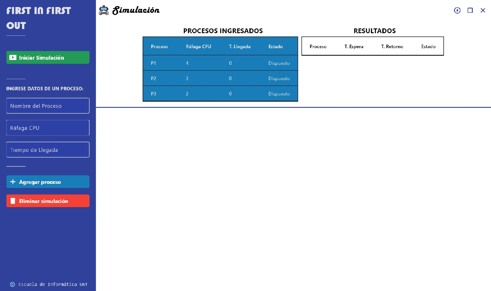
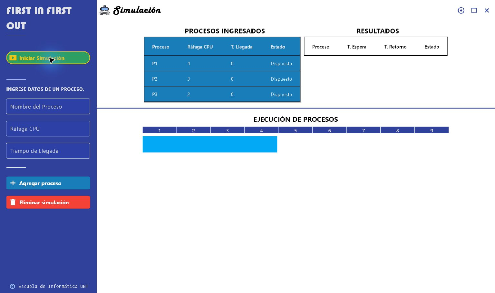
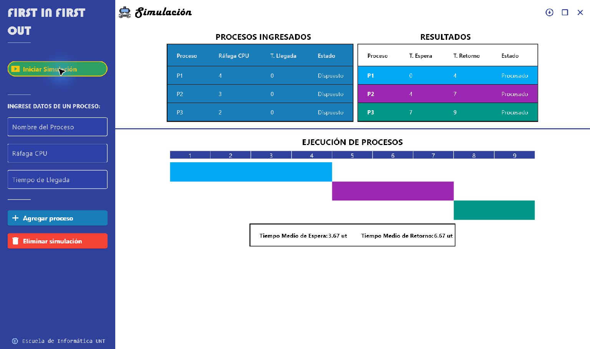

# Simulador FIFO de planificación de CPU

Aplicación de escritorio hecha con Python y Flet para visualizar cómo se ejecutan los procesos con el algoritmo FIFO (First In, First Out). Los procesos se atienden por orden de llegada y cada uno conserva la CPU hasta completar su ráfaga.

## Qué puedes hacer

- Agregar procesos indicando su nombre, ráfaga de CPU y tiempo de llegada.
- Ver la ejecución de cada proceso en una línea de tiempo animada.
- Consultar los resultados por proceso y los promedios que muestra el simulador.
- Limpiar la simulación para probar otro conjunto de datos.

## Capturas

### Procesos listos para ejecutar



### Simulación en curso



### Resultados y promedios




## Ejecutar desde el código fuente

Desde la raíz del repositorio, con Python instalado:

```powershell
py -m venv .venv
.\.venv\Scripts\python.exe -m pip install "flet[all]==0.26.0"
.\.venv\Scripts\flet.exe run src/main.py
```

## Versión para Windows

Desde **Releases** en GitHub, descarga el ZIP para Windows, extrae su contenido y abre `fifo.exe` en la carpeta extraída. Conserva juntos el ejecutable y los archivos que lo acompañan.

## Limitación conocida

El simulador muestra como tiempo de retorno la suma acumulada de las ráfagas. Cuando los procesos llegan en momentos distintos, esa cifra puede diferir del tiempo de retorno real, que se calcula restando el tiempo de llegada al tiempo de finalización.
